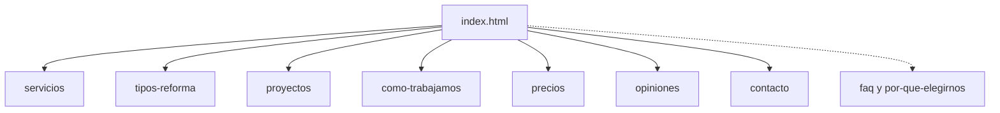

# Análisis de B-Edificación Arquitectos

Brief de desarrollo a partir de la web publicada y del repositorio. Este documento no ejecuta el desarrollo: fija qué existe, qué está desalineado y en qué orden conviene construirlo.

Fuentes revisadas el 23 de octubre de 2026:

- Web: [https://reformasmalagas.vercel.app/](https://reformasmalagas.vercel.app/)
- Repositorio: [https://github.com/javizx/reformas_malaga](https://github.com/javizx/reformas_malaga) (rama `main`, último push el 8 de octubre de 2026)
- La carpeta local de este proyecto estaba vacía al redactar el brief. El código vive en GitHub y en Vercel.

## 1. Producto

Landing de conversión para **B-Edificación Arquitectos**, estudio de arquitectura y reformas integrales en Málaga y Costa del Sol.

Promesa comercial:

- Proyecto de arquitecto, obra y licencias en un único equipo.
- Presupuesto cerrado por contrato, sin desviaciones.
- Un arquitecto colegiado como único interlocutor.
- Visita técnica gratuita y respuesta en 24 horas.
- Servicio llave en mano: planos, licencias, ejecución, limpieza y entrega con garantías.

El negocio, el teléfono, el email y el número de colegiado que aparecen en la web son datos de ejemplo. Hay que tratarlos como placeholders hasta tener los datos reales del cliente.

Title de la home: `B-Edificación Arquitectos Málaga | Reformas Integrales y Arquitectura`.

Meta description: «Estudio de arquitectura y reformas integrales en Málaga. Proyecto de arquitecto, obra y licencias en un único equipo. Presupuesto cerrado por contrato sin sorpresas.»

Idioma: `es`.

## 2. Stack actual

Sitio estático. Cada ruta es un HTML completo, sin framework, sin build y sin componentes compartidos.

| Pieza | Detalle |
| --- | --- |
| Marcado | HTML por página |
| Estilos | Tailwind por CDN (`https://cdn.tailwindcss.com/`) y `tailwind.config` inline |
| Tipografías | Outfit (títulos) y Manrope (cuerpo), Google Fonts |
| Iconos | Material Symbols Outlined |
| Despliegue | Vercel, preset de sitio estático. [`vercel.json`](https://github.com/javizx/reformas_malaga/blob/main/vercel.json) solo contiene `"cleanUrls": true` |
| Formulario | `#leadForm` envía a Formspree: `https://formspree.io/f/xvkzaqlg` |
| Interacción | JavaScript inline: menú móvil, comparadores, calculadora, acordeón FAQ, modal de vídeo y estado de éxito del formulario |

README del repo: landing responsive, identidad «Warm Architectural Precision», comparadores antes/después, calculadora por m², formulario, modal de testimonio, FAQ y barra fija móvil de llamada y WhatsApp.

## 3. Mapa del repositorio

Repositorio público `javizx/reformas_malaga`. Lenguaje principal: HTML. Tamaño aproximado: 551 KB. Homepage declarada: `https://reformasmalagas.vercel.app`. Sin licencia, sin topics y sin GitHub Pages.

### Páginas publicadas

| Ruta | Archivo | Tamaño aprox. | Title |
| --- | --- | --- | --- |
| `/` | `index.html` | 135 KB | B-Edificación Arquitectos Málaga \| Reformas Integrales y Arquitectura |
| `/servicios` | `servicios/index.html` | 28 KB | Servicios de Reforma en Málaga \| B-Edificación Arquitectos |
| `/tipos-reforma` | `tipos-reforma/index.html` | 29 KB | Tipos de Reforma \| B-Edificación Arquitectos Málaga |
| `/proyectos` | `proyectos/index.html` | 28 KB | Proyectos Antes y Después \| B-Edificación Arquitectos Málaga |
| `/como-trabajamos` | `como-trabajamos/index.html` | 26 KB | Cómo Trabajamos \| B-Edificación Arquitectos Málaga |
| `/precios` | `precios/index.html` | 26 KB | Calculadora de Precios y Presupuesto \| B-Edificación Arquitectos Málaga |
| `/opiniones` | `opiniones/index.html` | 28 KB | Opiniones y Reseñas de Clientes \| B-Edificación Arquitectos Málaga |
| `/contacto` | `contacto/index.html` | 30 KB | Contacto y Presupuesto \| B-Edificación Arquitectos Málaga |

### Material que no es una ruta pública

- `warm_architectural_precision/DESIGN.md` (~11 KB). Sistema visual «Warm Architectural Precision». Es la fuente de color, tipo, rejilla y componentes.
- `b_edificaci_n_arquitectos_landing_desktop/code.html` (~98 KB) y `screen.png`. Prototipo de escritorio.
- `b_edificaci_n_arquitectos_landing_m_vil/code.html` (~73 KB) y `screen.png`. Prototipo móvil.
- `reformas_malaga/index.html` (~133 KB). Copia casi del mismo tamaño que el `index.html` de la raíz. No debe desplegarse como segunda home.
- `.gitignore` y `README.md`.

### Rutas enlazadas que no existen

El menú móvil de la home apunta a páginas que no están en el repo:

- `/faq` responde **404**.
- `/por-que-elegirnos` no tiene carpeta.

En la home, FAQ y «por qué elegirnos» sí existen como anclas (`#faq`, `#por-que-elegirnos`). El fallo está en tratarlas como rutas propias.

## 4. Home, sección a sección

Anclas reales de la home: `#servicios`, `#tipos-reforma`, `#proyectos`, `#como-trabajamos`, `#precios`, `#opiniones`, `#por-que-elegirnos`, `#faq`, `#contacto-presupuesto`.

La navegación principal no usa esas anclas. Va a páginas independientes: Servicios, Tipos de reforma, Proyectos, Cómo trabajamos, Precios, Opiniones y Contacto. El botón «Pide presupuesto gratis» abre WhatsApp.

### Barra superior y cabecera

- Teléfono `952 12 34 56` (`tel:952123456`) y email `info@reformasejemplo.es`.
- «Málaga & Costa del Sol» y pastilla «Respuesta en 24 h».
- Cabecera sticky con logo «B-Edificación / Arquitectos Málaga», enlaces de sección y CTA terracota.
- En móvil hay menú desplegable y una barra fija con Llamar y WhatsApp.

### Hero

- Etiqueta: «Estudio de arquitectura e interiorismo colegiado en Málaga».
- H1: «Reformas integrales en Málaga, de la idea a las llaves en la mano.» La frase «llaves en la mano» va en terracota.
- Subtítulo: proyecto, obra y licencias en un único equipo; presupuesto cerrado por contrato.
- CTAs: «Solicitar presupuesto gratis» (WhatsApp) y «Llamar al 952 12 34 56».
- Tres pruebas rápidas: presupuesto cerrado, un único interlocutor, gestión de licencias.
- Tarjeta sobre la foto: «Último proyecto entregado · Reforma Integral La Malagueta · 145 m² · Eficiencia Clase A · Llave en mano».

### Métricas y avales

- +15 años de experiencia.
- +320 reformas (viviendas, áticos y locales).
- 4,9/5 en Google, más de 140 reseñas.
- 98 % de clientes que recomiendan.
- Avales citados: COAMA, Cámara de Comercio de Málaga, Promálaga Red, AMUPEMA Málaga, BNI Málaga Excelencia, ASEMAS (seguro decenal).

### Servicios (`#servicios`)

«Qué incluye una reforma integral en B-Edificación». Seis fases:

1. Proyecto y diseño: planos, redistribución y renders 3D.
2. Licencias y trámites: Declaración Responsable, licencia de obra mayor y tasas ante Urbanismo de Málaga.
3. Demolición y albañilería: desescombro, apeos y aislamiento termoacústico.
4. Instalaciones: fontanería, boletín eléctrico y aerotermia.
5. Acabados y carpintería: microcemento, porcelánico, rotura de puente térmico y mobiliario a medida.
6. Dirección de obra: inspección del arquitecto e informes fotográficos semanales.

Cierre: visita gratuita de un arquitecto colegiado.

`/servicios` repite este bloque de seis fases, con un hero propio («Servicios de Reforma Integral en Málaga») y el mismo pie.

### Tipos de reforma (`#tipos-reforma`)

En la home hay cinco tipos:

- Reforma integral de vivienda.
- Rehabilitación de fachadas (SATE, elementos catalogados, salinidad costera).
- Rehabilitación de cubiertas.
- Reforma de edificios y comunidades (barreras, ascensor a cota cero, zaguanes, bajantes).
- Reforma de naves industriales (CTE, pavimentos, licencia de actividad).

`/tipos-reforma` **no copia esta lista**. Publica otra:

- Reformas integrales de viviendas.
- Reforma de cocinas y baños.
- Adecuación de locales comerciales (actividad, apertura, accesibilidad, insonorización).
- Rehabilitación de comunidades y fachadas (SATE, ITE/IEE, subvenciones).

### Proyectos (`#proyectos`)

Tres comparadores antes/después (slider 0–100, valor inicial 50):

| Obra en la home | Datos | Cita |
| --- | --- | --- |
| Reforma integral diáfana con terraza | Ático La Malagueta · 145 m² · 3 meses | Marta y Carlos R. |
| Restauración señorial y diseño moderno | Centro histórico (el CTA dice «Centro Histórico») | Javier G., inversor. Menciona PEPRI |
| Ampliación, eficiencia Passivhaus y piscina | El Limonar · 230 m² · 4,5 meses | Familia Ramos |

`/proyectos` muestra solo dos obras y con otro copy:

- La Malagueta · 145 m² · «Reforma Integral de Piso Señorío».
- Centro Histórico · 95 m² · «Reorganización de Cocina y Salón».

No aparece El Limonar. Los títulos de La Malagueta no coinciden entre home e interior.

### Cómo trabajamos (`#como-trabajamos`)

Cinco pasos en la home:

1. Visita y asesoramiento gratuito. 24–48 h. Plazo: inmediato.
2. Proyecto y presupuesto cerrado. 5–7 días.
3. Licencias y permisos. 2 a 4 semanas.
4. Obra con seguimiento semanal. 8 a 12 semanas. Informes cada viernes.
5. Entrega y garantía. Limpieza, certificados y póliza decenal. Garantía legal hasta 10 años.

`/como-trabajamos` reescribe los mismos cinco números con otro énfasis (renders 3D en el paso 2, contrato con penalización en el paso 3, licencia dentro del paso 4, checklist de entrega en el paso 5) y sin los plazos de la home.

### Precios (`#precios`)

Tres gamas en tarjetas, presentadas como rangos reales de mercado en Málaga para reforma con proyecto de arquitecto:

| Gama | Rango | Incluye en la home |
| --- | --- | --- |
| Básica / Esencial | 450–600 €/m² | Cocina y baños funcionales, laminado AC5, mecanismos básicos, pintura |
| Media / Integral Confort | 650–850 €/m² | Redistribución, instalaciones nuevas con boletín, clima, ventanas RPT, dirección de arquitecto |
| Completa / Premium | 900–1.300 €/m² | Aerotermia y suelo radiante, microcemento o mármol, cocina de autor, domótica |

Calculadora de la home:

- Superficie 30–300 m², valor inicial 90 m². Marcas visibles: 30, 150 y 300.
- Botones: Básica 500 €/m², Media 750 €/m², Completa 1.100 €/m².
- Con 90 m² y gama media muestra **58.500 € – 76.500 €**.
- Ese rango sale de la banda media (650–850), no del punto medio de 750: `90 × 650 = 58.500` y `90 × 850 = 76.500`.
- Nota: presupuesto orientativo **sin IVA**. El precio cerrado llega tras la visita.

`/precios` es otra calculadora:

- Arranca en **80 m²**. Marcas: 30, 100, 180 y 250. El tope visible no es 300.
- Misma lógica de bandas: 80 m² en media muestra 52.000 € – 68.000 €.
- La nota dice que incluye proyecto, demoliciones, instalaciones, acabados **e IVA orientativo**. Contradice el «sin IVA» de la home.

### Opiniones (`#opiniones`)

Home: 4,9/5 y más de 140 opiniones. Tres reseñas:

- Alejandro Lorca, piso en Teatinos.
- Carmen Rodríguez, ático en Paseo Marítimo Antonio Banderas. Menciona 10 semanas.
- Fernando Escudero, chalet en Pedregalejo. Menciona aerotermia y factura eléctrica.

Debajo, bloque de vídeo (2:45) de Elena y Gonzalo, Calle Molina Lario, 120 m², eficiencia clase A. Hay modal de reproducción.

`/opiniones` usa otras tres personas:

- Elena y Alberto, La Malagueta, 140 m², hace 2 semanas.
- Carlos Moreno, Teatinos, 95 m².
- Marta R., ático en Pedregalejo, 110 m².

No coinciden nombres, metros ni barrios con la home, salvo el motivo general (plazos, licencia, reportes).

### Por qué elegirnos (`#por-que-elegirnos`)

Cuatro motivos: arquitectos colegiados COAMA con seguro decenal, presupuesto cerrado, plazos con cronograma y penalización, garantía y postventa.

Tabla comparativa «B-Edificación vs. contratar oficios por separado»: responsable único, precio cerrado frente a desvíos del 20–45 %, licencias tramitadas por el estudio, fecha garantizada y seguro decenal ASEMAS.

Esta sección no tiene página propia. El enlace `/por-que-elegirnos` del menú móvil cae fuera del sitio.

### FAQ (`#faq`)

Ocho preguntas, solo en la home:

1. Duración: obra de 8–12 semanas en 80–110 m²; proyecto y licencia, 3–4 semanas antes.
2. Licencia en Málaga: Declaración Responsable si no hay estructura; licencia urbanística si hay PEPRI o pilares.
3. Llave en mano: planos, diseño, permisos, tasas, oficios, limpieza y garantías.
4. Reforma (interior privativo) frente a rehabilitación (envolvente, estructura, accesibilidad).
5. Pago por certificaciones: anticipo de acopio y licencias, hitos y liquidación al entregar.
6. Garantías LOE: 1 año acabados, 3 años instalaciones y habitabilidad, 10 años estructura, con ASEMAS.
7. Vivir en casa: no recomendable en reforma integral; sí se puede planificar por fases si es parcial.
8. Zona: Costa del Sol (Torremolinos, Benalmádena, Fuengirola, Mijas, Marbella, Estepona) y Axarquía (Rincón de la Victoria, Vélez-Málaga, Torre del Mar).

`/faq` no existe (404).

### Servicios relacionados

Tres fichas, solo en la home, con CTA a WhatsApp:

- Cambio de uso de local a vivienda (PGOU, cédula de habitabilidad).
- Proyectos de demolición (derribo, plan de RCD, dirección facultativa).
- Cédula de habitabilidad, certificado energético, ITE e IEE.

### Contacto en la home (`#contacto-presupuesto`)

Bloque oscuro: «Cuéntanos tu reforma y te respondemos en 24 horas».

Formulario `#leadForm`:

- Nombre y apellidos (obligatorio).
- Teléfono móvil (obligatorio).
- Correo (opcional).
- Mensaje (opcional).
- Checkbox obligatorio de privacidad. El enlace «política de privacidad» apunta a `#politica-privacidad`, que no es una página.
- Envío: «Quiero mi presupuesto gratis».
- Acción: `https://formspree.io/f/xvkzaqlg`.
- Mensaje de éxito ya maquetado: «¡Solicitud recibida con éxito!» y promesa de contacto en 24 horas laborables.

Datos al lado del formulario:

- Teléfono `952 12 34 56`.
- WhatsApp (el número del enlace es `34612345678`, no el fijo).
- Email `info@reformasejemplo.es`.
- Calle Larios 12, Planta 3ª, 29005 Málaga.
- Horario en la home: lunes a viernes, **08:30 a 19:30** ininterrumpido.

`/contacto` repite oficina, teléfono, WhatsApp y email, con horario **9:00–19:00**.

### Pie

- Claim del estudio, dirección y teléfono.
- Servicios (anclas de la home, no las rutas).
- Estudio: Nosotros (`#inicio`), proyectos, metodología, calculadora, opiniones.
- «Colegiados COAMA Málaga núm. 2841. Seguro decenal Asemas y certificación BREEAM.»
- Redes: LinkedIn, Instagram, Facebook y YouTube apuntan a dominios genéricos (`linkedin.com`, `instagram.com`, `facebook.com`, `youtube.com`).
- Aviso legal, política de privacidad y cookies apuntan a `#`.
- Módulo de vídeo: Elena y Gonzalo, Calle Molina Lario, 120 m².

## 5. Sistema visual

Nombre del sistema: **Warm Architectural Precision**. Fuente: `warm_architectural_precision/DESIGN.md`, ajustado en el `tailwind.config` que corre en la home.

Intención: rigor de estudio de arquitectura y calidez mediterránea. Rejilla tipo plano, mucho aire, líneas finas, fotos de obra. Poca sombra; la profundidad sale de cambiar de superficie (yeso, piedra, carbón).

### Color en la web viva

| Token | Hex | Uso |
| --- | --- | --- |
| Fondo / background | `#f9f9f6` | Lienzo |
| Superficie baja | `#f4f4f1` | Bandas alternas |
| Superficie | `#eeeeeb` | Bloques técnicos |
| Línea alta | `#e8e8e5` | Bordes |
| Texto | `#1a1c1a` | Títulos y cuerpo |
| Texto secundario | `#444748` | Apoyos |
| CTA / secondary | `#c85a32` | Botones de conversión |
| Hover CTA | `#b85028` | `secondary-dark` |
| WhatsApp | `#25D366` | Canal directo |
| Bloque de cierre | `#1A1A1A` | Sección de contacto |

`DESIGN.md` describe el carbón como `#1A1A1A` y el fondo como `#FBFBF9`. La web usa `#1a1c1a` y `#f9f9f6`. Para el desarrollo, manda la paleta que ya está en el `tailwind.config` de la home, y `DESIGN.md` sirve como regla de componentes.

### Tipo

- Títulos: Outfit. Display de escritorio 56 px / 700; en la home el H1 medido queda en 54 px.
- Cuerpo: Manrope, 16–18 px, interlineado holgado.
- Etiquetas técnicas: mayúsculas, tracking amplio (métricas, «24–48 horas», chips de proyecto).

### Layout y componentes

- Canvas máximo 1440 px. Gutters de 32 px en escritorio y 16 px en móvil. Márgenes laterales 64 px / 20 px.
- Radios contenidos: 8 px en botones, 12 px en tarjetas y fotos. Sin círculos en las imágenes de obra.
- Botones de al menos 48 px de alto. Primario terracota, secundario carbón o contorno.
- Tarjetas planas con borde de 1 px. Sombra solo en hover o en modales.
- Inputs blancos, 48 px, radio 8 px, label encima.

## 6. Datos de contacto (placeholders)

No usar estos datos como si fueran del cliente final. Están puestos para la demo.

| Dato | Valor en la web | Nota |
| --- | --- | --- |
| Teléfono | 952 12 34 56 | Fijo de ejemplo |
| WhatsApp | 34612345678 | No coincide con el fijo. Mensaje fijo: «Hola, quiero presupuesto para una reforma» |
| Email | info@reformasejemplo.es | Dominio de ejemplo |
| Dirección | Calle Larios 12, 3º, 29005 Málaga | |
| Horario | 08:30–19:30 en la home; 9:00–19:00 en `/contacto` | Hay que unificar |
| Colegiado | COAMA Málaga núm. 2841 | Aparece como dato real junto a ASEMAS y BREEAM |
| Redes | Dominios genéricos | Sin perfiles concretos |
| Formspree | `xvkzaqlg` | Hay que confirmar si el buzón es el del proyecto o uno de prueba |

Casi todos los CTA de la home (presupuesto, «ver más», proyectos, servicios relacionados, calculadora) abren el mismo WhatsApp. Pocos bajan al formulario o a `/contacto`.

## 7. Deuda a resolver antes o durante el desarrollo

1. **Copy partido.** Home e interiores no cuentan la misma oferta: tipos de obra, pasos, proyectos, reseñas, IVA y horario.
2. **Rutas rotas.** `/faq` es 404. `/por-que-elegirnos` no existe como carpeta.
3. **Legal inexistente.** Aviso legal, privacidad y cookies van a `#`. El checkbox enlaza un ancla que no abre una política.
4. **Placeholders mezclados con claims legales.** LOE, ASEMAS, BREEAM y el número de colegiado se presentan como hechos sobre un negocio de ejemplo (`reformasejemplo.es`, teléfono inventado).
5. **HTML duplicado.** Cabecera, pie, CTA y bloques se copian en cada `index.html`. Un cambio de teléfono hay que hacerlo en ocho archivos, más el duplicado `reformas_malaga/index.html` y los dos prototipos.
6. **Tailwind por CDN y JS inline.** Válido para la demo. Frágil si el sitio crece o si se quiere versionar el CSS.
7. **Imágenes externas.** Las fotos salen de `lh3.googleusercontent.com`. Si esas URLs caducan, la web se queda sin obra.
8. **CTAs de un solo canal.** El formulario existe, pero la mayoría de botones se saltan la página y abren WhatsApp.
9. **Calculadora con dos contratos distintos.** Misma idea (banda baja y alta por m²) y dos copys de IVA, dos rangos de metros y dos valores iniciales.
10. **Prototipos y copia anidada en el mismo árbol que el sitio.** Si se despliega la raíz tal cual, `reformas_malaga/`, los `code.html` y `DESIGN.md` no deberían ser páginas públicas. Con `cleanUrls`, conviene revisar que esas carpetas no queden enlazadas.

## 8. Orden de desarrollo propuesto

Esto es el checklist para la siguiente fase. No está ejecutado.

1. **Traer el repo a esta carpeta** (`git clone` de `https://github.com/javizx/reformas_malaga.git` sobre el directorio actual, o copiar el árbol de `main`). Esta carpeta es el sitio de trabajo; GitHub sigue siendo la referencia de la demo.
2. **Decidir el stack antes de tocar páginas.** Dos caminos, y hay que confirmar uno:
   - Mantener HTML estático: más rápido para igualar la demo, pero la cabecera y el pie siguen duplicados.
   - Pasar a componentes (por ejemplo Astro o un HTML con parciales): un solo header, un solo pie y datos de contacto en un solo sitio. Recomendado si se va a vender y mantener la web.
3. **Unificar el copy** con la home como fuente, salvo que se decida lo contrario:
   - Tipos de reforma: o las cinco categorías de la home, o las cuatro de `/tipos-reforma`, no las dos.
   - Proyectos: tres obras de la home, con los mismos títulos en `/proyectos`.
   - Proceso: cinco pasos con los plazos de la home.
   - Precios: bandas 450–600, 650–850 y 900–1.300; calculadora única; decir sin IVA en ambos sitios; rango 30–300 m².
   - Opiniones: un solo set de reseñas.
   - Horario: un solo tramo.
4. **Sustituir placeholders** cuando existan teléfono, WhatsApp, email, dirección, horario, redes y número de colegiado reales. Hasta entonces, dejarlos marcados en un único archivo de datos.
5. **Arreglar navegación.**
   - Menú móvil: `#faq` y `#por-que-elegirnos` en la home, o páginas nuevas si se quieren indexar.
   - CTA principal: formulario o WhatsApp, pero no los dos mensajes a la vez sin criterio. Propuesta: presupuesto y «ver más» al formulario; llamada y WhatsApp solo en la barra de contacto.
6. **Páginas legales mínimas:** aviso legal, privacidad y cookies, enlazadas desde el pie y desde el checkbox.
7. **Imágenes en el repo** (`/imagenes` o similar), con texto alternativo, en lugar de URLs de Google.
8. **Quitar del despliegue** `reformas_malaga/index.html` y las carpetas de prototipo, o moverlas fuera de la raíz pública.
9. **Probar en navegador** home e interiores, escritorio y móvil: menú, sliders, calculadora (90 m² media = 58.500–76.500 € sin IVA), FAQ, formulario y que `/faq` deje de ser 404.

### Decisión que hay que confirmar antes de codear

¿Se rehace el sitio con componentes o se edita el HTML estático tal como está en GitHub?

Recomendación de este brief: componentes, con la home como fuente de verdad del copy y un solo módulo de datos de contacto. El HTML actual sirve de referencia visual, no como base que haya que parchear ocho veces.
